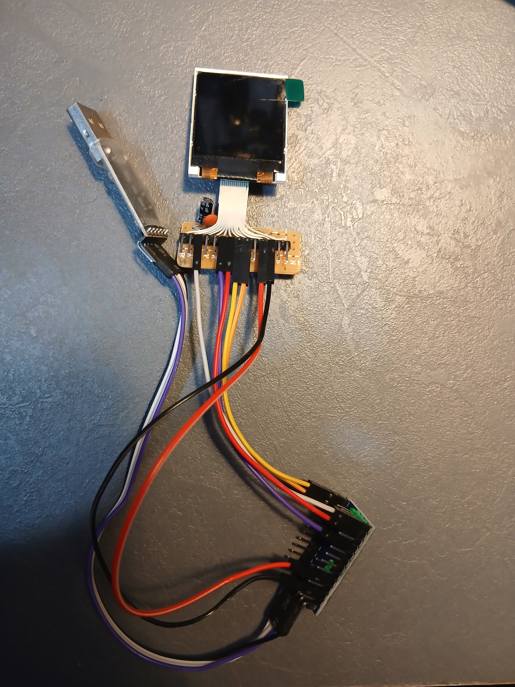

# راهنمای سیم‌بندی و برنامه تست نمایشگر رنگی ۱.۴۴ اینچ SPI TFT با درایور ST7735 و برد Arduino Pro Mini 3.3V

این پروژه به منظور راه‌اندازی، سیم‌بندی اصولی، اعتبارسنجی کیفیت تصویر و تست عملکرد ماژول نمایشگر **1.44 اینچ TFT تمام رنگ با درایور ST7735** به همراه برد کم‌مصرف پردازنده **Arduino Pro Mini 3.3V (8MHz)** طراحی شده است.

---

## 📦 سخت‌افزارهای مورد استفاده

| ردیف | نام ماژول | کد کالا (SKU) | تراشه درایور / میکرو | رزولوشن / فرکانس | پروتکل ارتباطی | لینک مرجع در داشبورد قطعات |
| :---: | :--- | :---: | :---: | :---: | :---: | :---: |
| ۱ | **نمایشگر TFT تمام رنگ 1.44 اینچ دارای ارتباط SPI و چیپ درایور ST7735** | `LCD-01-155` | Sitronix ST7735R | 128x128 Pixels (65K RGB565) | 4-Wire Hardware SPI | [مشاهده در داشبورد قطعات](../../index.html#hw-lcd-01-155) |
| ۲ | **برد آردوینو پرومینی مدل 3.3 ولت - Arduino Pro Mini** | `ARD-01-049` | ATmega328P | 8 MHz / 3.3V Logic | Hardware SPI (MOSI:11, SCK:13) | [مشاهده در داشبورد قطعات](../../index.html#hw-ard-01-049) |

---

## ⚡ مزیت کلیدی استفاده از برد Pro Mini نسخه ۳.۳ ولت (Zero Level Shifter)

یکی از چالش‌های رایج اتصال نمایشگرهای TFT سری ST7735 به آردوینوهای استاندارد (نظیر UNO یا Mega)، عدم تحمل ولتاژ ۵ ولت بر روی خطوط داده نمایشگر است که نیاز به استفاده از آی‌سی سطح‌سنج (Level Shifter) یا تقسیم مقاومتی دارد.  
در این پروژه، به دلیل استفاده از **برد Arduino Pro Mini مدل 3.3 ولت**:
1. **سازگاری ۱۰۰٪ ولتاژ**: ولتاژ تغذیه و سطح منطقی (Logic Level) تمام پایه‌های دیجیتال پردازنده دقیقاً **۳.۳ ولت** است.
2. **اتصال مستقیم و ایمن**: تمام خطوط داده SPI بدون هیچ‌گونه مقاومت سری یا ماژول واسط مستقیماً به پایه‌های آردوینو متصل می‌شوند.
3. **مصرف انرژی فوق‌العاده پایین**: ترکیب ATmega328P در فرکانس ۸ مگاهرتز با نمایشگر ۱.۴۴ اینچی، ایده‌آل‌ترین گزینه برای پروژه‌های پرتابل و گجت‌های باتری‌محور است.

---

## 🔌 جدول سیم‌بندی و پین‌اوت کابل فلت ۱۴ پین نمایشگر (Z144SN005 14-Pin FPC Pinout)

روی کابل فلت یا برد آداپتور این نمایشگر (**مدل Z144SN005 با درایور ST7735**)، نام پایه‌ها چاپ نشده و **تنها شماره‌های ۱ تا ۱۴** مشخص شده است. اتصالات دقیق این ۱۴ پین به برد **Arduino Pro Mini 3.3V** بر اساس مپ استاندارد سخت‌افزاری به شرح زیر است:

| شماره پین فلت | نام سیگنال | پین متناظر آردوینو Pro Mini | رنگ پیشنهادی | شرح عملکرد و نحوه اتصال |
| :---: | :---: | :---: | :---: | :--- |
| **۱** | **NC** | *بدون اتصال* | - | پایه آزاد (No Connection) |
| **۲** | **GND** | **GND** | ⚫ مشکی | اتصال زمین مدار (Ground) |
| **۳** | **LED-** | **GND** | ⚫ مشکی | کاتد ال‌ای‌دی نور پس‌زمینه (اتصال به زمین) |
| **۴** | **LED+** | **VCC (3.3V)** با مقاومت ۲۲Ω (یا **D6**) | 🔴 قرمز | آند ال‌ای‌دی نور پس‌زمینه (با مقاومت سری ۲۲ اهم یا اتصال به پین D6 جهت کنترل روشنایی با PWM) |
| **۵** | **GND** | **GND** | ⚫ مشکی | اتصال زمین مدار (Ground) |
| **۶** | **/RESET** | **D8** | 🟡 زرد | ریست سخت‌افزاری نمایشگر (Active Low) |
| **۷** | **A0 / DC** | **D9** | 🟢 سبز | انتخاب داده/فرمان (Command / Data) |
| **۸** | **SDA** | **D11 (MOSI)** | 🔵 آبی | خط داده سخت‌افزاری SPI میکروکنترلر |
| **۹** | **SCK** | **D13 (SCK)** | 🟣 بنفش | خط کلاک سخت‌افزاری SPI میکروکنترلر |
| **۱۰** | **VCC** | **VCC (3.3V)** | 🔴 قرمز | تغذیه ۳.۳ ولت اصلی مدار درایور ST7735 |
| **۱۱** | **IOVCC** | **VCC (3.3V)** | 🔴 قرمز | تغذیه ۳.۳ ولت خطوط دیجیتال و منطقی |
| **۱۲** | **CS** | **D10 (SS)** | 🟠 نارنجی | پایه انتخاب تراشه (Chip Select - Active Low) روی گذرگاه SPI |
| **۱۳** | **GND** | **GND** | ⚫ مشکی | اتصال زمین مدار (Ground) |
| **۱۴** | **NC** | *بدون اتصال* | - | پایه آزاد (No Connection) |

---

### 📋 راهنمای سریع اتصال سیم‌ها بر اساس پایه‌های آردوینو Pro Mini

جهت سهولت در سیم‌بندی، پایه‌ها را به صورت دسته‌ای متصل فرمایید:

1. **پایه‌های زمین (GND آردوینو):** به پین‌های **2**، **3** (LED منفی)، **5** و **13** فلت متصل شوند.
2. **تغذیه مثبت ۳.۳ ولت (VCC آردوینو):** به پین‌های **10** (VCC) و **11** (IOVCC) وصل شوند. همچنین پین **4** (LED مثبت) از طریق یک مقاومت ۲۲ اهم به ۳.۳V وصل شود (یا به پین D6 جهت کنترل PWM).
3. **پایه‌های سیگنال و گذرگاه سخت‌افزاری SPI:**
   - پین **6** فلت (/RESET) ⬅️ متصل به **D8**
   - پین **7** فلت (A0/DC) ⬅️ متصل به **D9**
   - پین **8** فلت (SDA) ⬅️ متصل به **D11** (Hardware MOSI)
   - پین **9** فلت (SCK) ⬅️ متصل به **D13** (Hardware SCK)
   - پین **12** فلت (CS) ⬅️ متصل به **D10** (Hardware SS)
4. **پین‌های آزاد:** پین‌های **1** و **14** بدون اتصال رها شوند (NC).

> ⚠️ **هشدار مهم ولتاژ**: پین‌های تغذیه (VCC و IOVCC) و خطوط سیگنال به هیچ عنوان نباید به ولتاژ ۵ ولت وصل شوند. برد آردوینو پرومینی ۳.۳ ولتی به صورت مستقیم و بدون نیاز به مدار واسط سیگنال‌های ایمن ۳.۳ ولت تولید می‌کند.

---

## 📷 تصویر پیاده‌سازی و سیم‌بندی واقعی مدار (Real Hardware Setup)

تصویر زیر چیدمان واقعی مدار بسته شده شامل نمایشگر ۱.۴۴ اینچ ST7735 لحیم شده بر روی برد آداپتور، اتصالات سیم‌های جامپر به پایه‌های برد **Arduino Pro Mini 3.3V** و اتصال ماژول مبدل سریال USB-to-TTL را نشان می‌دهد:

  
  
<em>تصویر ۱: سیم‌بندی واقعی ماژول Z144SN005 بر روی برد رابط فلت و اتصال به پایه‌های Arduino Pro Mini</em>

---

## 📚 کتابخانه‌های مورد نیاز آردوینو (Arduino Libraries)

قبل از کامپایل برنامه، دو کتابخانه رسمی زیر را از منوی **Tools -> Manage Libraries...** در نرم‌افزار Arduino IDE جستجو و نصب فرمایید:

1. **Adafruit GFX Library** (توسط *Adafruit*) - نسخه ۱.۱۱.۰ یا جدیدتر
2. **Adafruit ST7735 and ST7789 Library** (توسط *Adafruit*) - نسخه ۱.۱۰.۰ یا جدیدتر

---

## ⚙️ تنظیمات کامپایل و پروگرم در Arduino IDE

برد Arduino Pro Mini به دلیل ابعاد کوچک فاقد تراشه مبدل USB-to-Serial داخلی است؛ بنابراین از یک ماژول مبدل USB-to-TTL (مانند CH340، CP2102 یا FT232) با **تنظیم جامپر روی 3.3V** استفاده نمایید.

سیم‌بندی مبدل USB به پین‌های هدر برنامه‌ریزی Pro Mini:
- **DTR مبدل** ⬅️ **DTR / GRN آردوینو** (جهت ریست خودکار هنگام آپلود)
- **TXD مبدل** ⬅️ **RXI آردوینو**
- **RXD مبدل** ⬅️ **TXO آردوینو**
- **VCC مبدل (3.3V)** ⬅️ **VCC آردوینو**
- **GND مبدل** ⬅️ **GND آردوینو**

از منوی **Tools** نرم‌افزار Arduino IDE تنظیمات زیر را انتخاب نمایید:
- **Board:** `Arduino Pro or Pro Mini`
- **Processor:** `ATmega328P (3.3V, 8 MHz)`  *(بسیار مهم: حتماً گزینه 3.3V, 8MHz انتخاب شود تا سرعت باودریت ارتباط سریال صحیح باشد)*
- **Port:** درگاه COM شناسایی شده توسط سیستم
- **Programmer:** `AVRISP mkII` (پیش‌فرض)

---

## 🧪 صفحات آزمون کد تست (Test Demo Screens)

فایل اسکتچ `ArduinoPro-mini_TFTST7735.ino` به صورت خودکار هر ۵ ثانیه بین ۶ صفحه آزمون زیر جابه‌جا می‌شود:

1. **صفحه ۱ - کارت هویت و مشخصات سیستم (System Specs Card)**:
   - نمایش مدل پردازنده (ATmega328P @ 8MHz 3.3V).
   - کنترلر نمایشگر (ST7735 128x128).
   - سنجشگر زنده حافظه SRAM آزاد (Free RAM) برای اطمینان از سلامت پشته حافظه میکروکنترلر.
2. **صفحه ۲ - وفاداری رنگ‌های ۱۶ بیتی و شیب خاکستری (Color Bars & Grayscale)**:
   - ترسیم ۸ نوار رنگی اصلی (قرمز، سبز، آبی، زرد، فیروزه‌ای، ارغوانی، سفید، نارنجی).
   - شیب پله‌ای ۱۶ مرحله‌ای Grayscale جهت راستی‌آزمایی توازن کنتراست و عدم معکوس بودن ساب‌پیکسل‌ها.
3. **صفحه ۳ - بنچ‌مارک اشکال هندسی (2D Geometry Benchmark)**:
   - ترسیم مستطیل‌های تودرتو، دوایر هم‌مرکز، مثلث‌های توپر و خطوط متقاطع شعاعی.
4. **صفحه ۴ - شبیه‌ساز داشبورد تله‌متری اینترنت اشیاء (IoT Telemetry Dashboard)**:
   - بارگراف متحرک سنسور دما و رطوبت با تغییرات پویا در زمان واقعی (Real-time).
   - نشانگر زمان کارکرد زنده (Uptime) و وضعیت اتصال.
5. **صفحه ۵ - تست تایپوگرافی و فونت‌ها (Typography & Font Scaling)**:
   - آزمون سایزهای متنی ۱ و ۲ و ۳، متون هایلایت شده با رنگ معکوس و برچسب‌های وضعیت.
6. **صفحه ۶ - انیمیشن روان توپ جهنده و نرخ فریم (Bounce Animation & FPS)**:
   - رندرینگ سریع و بدون پرش (Flicker-free) توپ متحرک جهت نمایش سرعت باس SPI در کلاک ۸ مگاهرتز آردوینو و محاسبه نرخ FPS زنده.

---

## 💻 کنترل تعاملی از طریق Serial Monitor

با باز کردن سریال مانیتور آردوینو با باودریت **115200**، علاوه بر مشاهده گزارش حافظه رم و وضعیت، می‌توانید فرامین زیر را ارسال کنید:

| کلید ارسالی | عملکرد |
| :---: | :--- |
| **`1` تا `6`** | پرش مستقیم به صفحه آزمون شماره ۱ تا ۶ و توقف روی آن |
| **`A`** | فعال‌سازی مجدد تعویض خودکار صفحات (Auto-cycle هر ۵ ثانیه) |
| **`R`** | چرخش ۹۰ درجه‌ای تصویر صفحه نمایش (جهت‌های ۰، ۹۰، ۱۸۰ و ۲۷۰ درجه) |
| **`I`** | معکوس کردن رنگ‌های تصویر (Invert Display) جهت رفع مشکل نمایشگرهای معکوس |
| **`B`** | تنظیم ۳ مرحله‌ای شدت روشنایی نور پس‌زمینه (۱۰۰٪، ۴۰٪، ۸٪ با PWM روی پین D6) |
| **`M`** | استعلام آنی حجم بایت‌های آزاد حافظه رم (Free SRAM) |
| **`?` یا `H`** | نمایش مجدد فهرست راهنمای فرامین |

---

## 🛠️ راهنمای عیب‌یابی و رفع اشکالات متداول (Troubleshooting)

| مشکل | علت احتمالی | راه‌حل قطعی |
| :--- | :--- | :--- |
| **صفحه کاملاً سفید است و تصویری ظاهر نمی‌شود** | عدم اتصال صحیح تغذیه یا خطوط کلاک و دیتای SPI | ۱. سیم‌های VCC و GND را بررسی کنید. ۲. مطمئن شوید خط SCL به پین **D13** و SDA به پین **D11** متصل باشد. ۳. اتصال پایه‌های کنترلی CS (D10)، DC (D9) و RST (D8) را راستی‌آزمایی نمایید. |
| **نور پس‌زمینه روشن نمی‌شود** | عدم اتصال پایه LED یا BLK | پایه `LED` ماژول را مستقیماً به پایه `VCC (3.3V)` آردوینو وصل نمایید. |
| **رنگ‌ها معکوس یا نگاتیو هستند (مثلاً آبی به جای قرمز)** | تفاوت مدل کنترلر ST7735B یا ST7735R در ماژول | کلید `i` را در سریال مانیتور ارسال کنید تا مد معکوس فعال شود، یا در تابع `setup` دستور `tft.invertDisplay(true);` را قرار دهید. |
| **یک نوار نویز چند پیکسلی در لبه تصویر دیده می‌شود** | تفاوت آفست تب‌های درایور (Black Tab vs Green Tab) | در کد اسکتچ دستور `tft.initR(INITR_144GREENTAB);` استفاده شده است. اگر ماژول شما دارای آفست است، آن را به `tft.initR(INITR_BLACKTAB);` تغییر دهید. |
| **برنامه در سریال مانیتور کاراکترهای نامفهوم چاپ می‌کند** | عدم تطابق باودریت یا فرکانس کاری پردازنده | ۱. باودریت مانیتور سریال را روی **115200** بگذارید. ۲. در منوی Tools گزینه Processor حتماً روی **ATmega328P (3.3V, 8 MHz)** باشد. |
