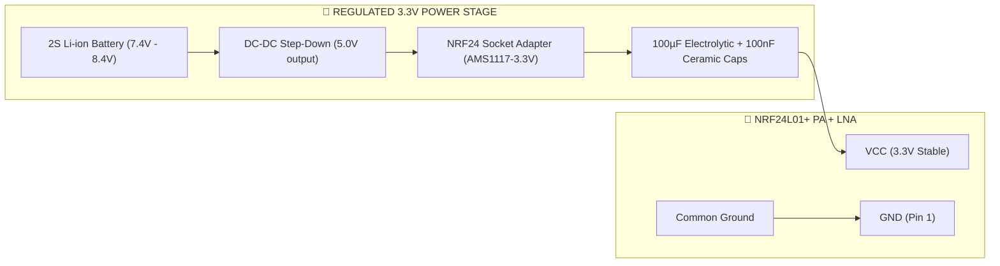
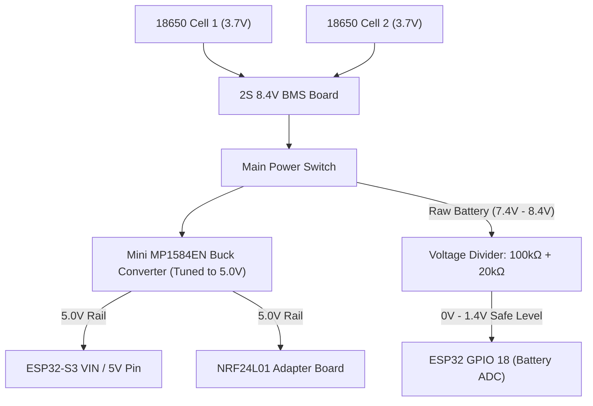

# 🛠️ DIY 8-Channel RC Controller — Hardware Specification
### Powered by ESP32-S3 & NRF24L01+ PA + LNA

-red?style=for-the-badge&logo=espressif)
-blue?style=for-the-badge)

-orange?style=for-the-badge)


---

## 📑 Table of Contents

- [🧠 1. ESP32 Model Selection: Why ESP32-S3 Wins](#hw-section-1)
  - [🥊 ESP32 Comparison Matrix](#hw-section-1-1)
  - [⭐ 5 Decisive Reasons Why ESP32-S3 is the Best Model](#hw-section-1-2)
- [📦 2. Complete Bill of Materials (BOM)](#hw-section-2)
  - [2.1 Core Electronics](#hw-section-2-1)
    - [1. Microcontroller: ESP32-S3-DevKitC-1](#hw-section-2-1-1)
    - [2. RF Transceiver: nRF24L01+ PA + LNA with SMA Antenna](#hw-section-2-1-2)
    - [3. Power Stability: NRF24L01 Socket Adapter Module](#hw-section-2-1-3)
    - [4. Gimbals: FrSky M9 Hall or FlySky FS-i6](#hw-section-2-1-4)
  - [2.2 Complete Hardware Component Checklist](#hw-section-2-2)
- [⚡ 3. Master Wiring Diagram & Pinout Schematic](#hw-section-3)
- [📡 4. NRF24L01+ PA + LNA Power & Decoupling Engineering](#hw-section-4)
  - [🛡️ Best Practice Connection Diagram](#hw-section-4-1)
  - [📌 Pinout of the NRF24L01 8-Pin Header](#hw-section-4-2)
- [🎛️ 5. Inputs & Control Peripherals Wiring](#hw-section-5)
  - [5.1 Gimbals & Rotary Potentiometers](#hw-section-5-1)
  - [5.2 3-Position Switch (SWB - CH5 Flight Modes)](#hw-section-5-2)
  - [5.3 2-Position Switch (SWA - CH6 Arm / Disarm)](#hw-section-5-3)
- [🔋 6. Power Management Subsystem (2S 18650)](#hw-section-6)
  - [🧮 Battery Voltage Divider Calculation](#hw-section-6-1)
- [📦 7. DIY Receiver Hardware Design](#hw-section-7)
- [✅ 8. Hardware Testing & Bring-Up Checklist](#hw-section-8)

---

<a id="hw-section-1"></a>
## 🧠 1. ESP32 Model Selection: Why ESP32-S3 Wins

When choosing an ESP32 for a precision RC transmitter, the choice of chip directly impacts stick accuracy, latency, and extra features:

<a id="hw-section-1-1"></a>
### 🥊 ESP32 Comparison Matrix

| Feature | ❌ ESP32 Classic (ESP32-WROOM-32) | ⚠️ ESP32-C3 | 🏆 **ESP32-S3 (Recommended)** |
| :--- | :---: | :---: | :---: |
| **CPU Architecture** | Dual-core Xtensa LX6 @ 240MHz | Single-core RISC-V @ 160MHz | **Dual-core Xtensa LX7 @ 240MHz** |
| **Available GPIOs** | ~28 pins | ~15 pins (Too few for 8-CH!) | **~44 pins (Plentiful for all controls)** |
| **ADC Linearity** | ❌ Poor (Severe non-linear curve) | Fair | **✅ High (Calibrated, smooth curve)** |
| **ADC Wi-Fi Conflict** | ❌ **ADC2 disabled when RF/BT on** | ADC2 limited | **✅ ADC1 has 10 dedicated pins with NO conflict** |
| **Native USB OTG** | ❌ No (Requires external UART chip) | ❌ No | **✅ YES (Acts as PC Flight Sim Joystick!)** |
| **Bluetooth Version** | Bluetooth 4.2 / BLE | Bluetooth 5.0 LE | **Bluetooth 5.0 LE + Long Range** |
| **Hardware Recommendation** | *Not recommended for RC* | *Good for small Receiver only* | **🔥 Perfect for Transmitter!** |

<a id="hw-section-1-2"></a>
> [!IMPORTANT]
> ### ⭐ 5 Decisive Reasons Why ESP32-S3 is the Best Model:
> 1. **Native USB HID (Simulator Ready):** The ESP32-S3 has built-in USB. Plug it into your PC and it instantly acts as a **USB Game Controller / RC Joystick** for drone simulators (*Liftoff, RealFlight, FPV Freerider*) without needing an adapter!
> 2. **Dedicated ADC1 Pins (Zero Wi-Fi/BLE Conflict):** On the classic ESP32, activating Bluetooth or Wi-Fi completely disables ADC2. The ESP32-S3 provides **10 dedicated ADC1 pins**, easily handling all 4 gimbal axes, 2 knobs, and battery voltage sensing while Bluetooth is active!
> 3. **High-Accuracy 12-Bit ADC:** Essential for smooth gimbal movement with zero stepping or jitter.
> 4. **Dual Core Division of Labor:** Core 0 runs the microsecond-accurate 15ms RF packet transmission loop; Core 1 handles Bluetooth smartphone app tuning and USB telemetry.
> 5. **Pin Availability:** Accommodates gimbals, 2 toggle switches, 2 rotary knobs, 8 trim buttons, status RGB LED, buzzer, battery sense, and SPI radio with pins to spare.

---

<a id="hw-section-2"></a>
## 📦 2. Complete Bill of Materials (BOM)

<a id="hw-section-2-1"></a>
### 2.1 Core Electronics

<a id="hw-section-2-1-1"></a>
#### 1. Microcontroller: **ESP32-S3-DevKitC-1** (N8R2 or N16R8)
<p align="center">
  
</p>

- **Processor:** Dual-Core 240MHz, 8MB/16MB Flash, 2MB/8MB PSRAM.
- **Role:** Main controller reading gimbals/switches, running filtering & calibration, and feeding the RF module.

---

<a id="hw-section-2-1-2"></a>
#### 2. RF Transceiver: **nRF24L01+ PA + LNA with SMA Antenna**
<p align="center">
  
</p>

- **Frequency:** 2.4 GHz ISM Band.
- **RF Power Output:** +20 dBm (100 mW).
- **LNA Gain:** 10 dB.
- **Range:** Up to 1.1 – 1.5 km in open air with 2.4GHz omni-directional antenna.
- **Interface:** High-speed SPI (up to 10 MHz).

---

<a id="hw-section-2-1-3"></a>
#### 3. Power Stability: **NRF24L01 Socket Adapter Module** (Crucial!)
<p align="center">
  
</p>

- **On-board Regulator:** AMS1117-3.3V with onboard filter capacitors.
- **Input Voltage:** 4.8V – 12V (connect directly to 5V rail).
- **Why it's required:** The PA+LNA module draws sudden **120mA – 150mA current spikes** during transmit pulses. Connecting it directly to a 3.3V MCU pin causes voltage drops, packet loss, or radio lockups!

---

<a id="hw-section-2-1-4"></a>
#### 4. Gimbals: **FrSky M9 Hall Gimbals** or **FlySky FS-i6 Replacement Gimbals**
<p align="center">
  
</p>

- **Left Gimbal (Mode 2):** Smooth friction ratchet for Throttle (Y-axis) + Self-centering Yaw (X-axis).
- **Right Gimbal (Mode 2):** Self-centering on both Pitch (Y-axis) and Roll (X-axis).
- **Sensor Type:** Hall effect (contactless) or high-grade 10kΩ linear potentiometers.

---

<a id="hw-section-2-2"></a>
### 2.2 Complete Hardware Component Checklist

| Item | Component | Specification | Quantity | Purpose |
| :-: | :--- | :--- | :-: | :--- |
| **1** | **ESP32-S3 DevKit** | ESP32-S3-DevKitC-1 (38 or 44 pin) | 1 | Transmitter brain & Bluetooth bridge |
| **2** | **NRF24L01+ PA + LNA** | 2.4GHz with SMA 2dBi/5dBi antenna | 1 | Long-range RF transmission |
| **3** | **NRF24L01 Adapter Board** | AMS1117-3.3V built-in adapter | 1 | Clean, noise-free 3.3V power to radio |
| **4** | **RC Gimbals** | Dual-axis gimbals (Hall or Pot) | 2 | Primary flight controls (CH1 – CH4) |
| **5** | **3-Position Toggle Switch** | ON-OFF-ON (SP3T miniature switch) | 1 | CH5 (Flight modes: Manual/Stab/RTH) |
| **6** | **2-Position Toggle Switch** | ON-ON (SPDT miniature switch) | 1 | CH6 (Arm / Disarm or Gear) |
| **7** | **Rotary Potentiometers** | 10 kΩ Linear (B10K) + Knobs | 2 | CH7 & CH8 (Camera tilt / Flaps / Aux) |
| **8** | **Momentary Push Buttons** | Tactile switches (or 2-way rockers) | 8 | Digital Trims (CH1–CH4 fine adjustment)|
| **9** | **Battery Pack** | 2S 18650 Li-ion (7.4V nominal) | 1 | Main portable power source |
| **10**| **2S BMS Protection Board** | 2S 8.4V 5A–10A BMS | 1 | Overcharge & over-discharge protection |
| **11**| **DC-DC Step-Down (Buck)** | Mini MP1584EN or LM2596 (set to 5.0V)| 1 | Converts 7.4V–8.4V battery to 5.0V |
| **12**| **Resistors for Battery Sense** | 100 kΩ and 20 kΩ (1% metal film) | 1 ea | Voltage divider to monitor battery |
| **13**| **Decoupling Capacitors** | 100 µF electrolytic + 100 nF ceramic| 1 ea | Extra RF rail smoothing |
| **14**| **Active Buzzer & LED** | 5V active buzzer + WS2812B RGB | 1 ea | Low battery alarm & status indication |

---

<a id="hw-section-3"></a>
## ⚡ 3. Master Wiring Diagram & Pinout Schematic

```
                                      ESP32-S3 DevKit
                             ┌──────────────────────────────┐
  [Right Stick - X (CH1)] ───┤ GPIO 1  (ADC1_CH0)           │
  [Right Stick - Y (CH2)] ───┤ GPIO 2  (ADC1_CH1)           │
  [Left Stick  - Y (CH3)] ───┤ GPIO 3  (ADC1_CH2)           │
  [Left Stick  - X (CH4)] ───┤ GPIO 4  (ADC1_CH3)           │
  [Rotary Pot VR1 (CH7)]  ───┤ GPIO 5  (ADC1_CH4)           │
  [Rotary Pot VR2 (CH8)]  ───┤ GPIO 6  (ADC1_CH5)           │
                             │                              │
  [SWB (3-pos) Terminal 1]──┤ GPIO 7  (Input Pullup)       │
  [SWB (3-pos) Terminal 2]──┤ GPIO 8  (Input Pullup)       │
  [SWA (2-pos) Terminal]  ───┤ GPIO 9  (Input Pullup)       │
                             │                              │
  [Trim CH1 Left / Right] ───┤ GPIO 10, GPIO 11 (Pullup)    │
  [Trim CH2 Down / Up]    ───┤ GPIO 12, GPIO 13 (Pullup)    │
  [Trim CH3 Down / Up]    ───┤ GPIO 14, GPIO 15 (Pullup)    │
  [Trim CH4 Left / Right] ───┤ GPIO 16, GPIO 17 (Pullup)    │
                             │                              │
  [Battery Voltage Sense] ───┤ GPIO 18 (ADC1_CH7)           │<── Divider: Batt(+) ──[100k]──┬──[20k]── GND
                             │                              │                               │
  [Low-Batt Audio Buzzer] ───┤ GPIO 21 (Digital Output)     │                               └── to GPIO 18
  [Status WS2812B LED]    ───┤ GPIO 38 (NeoPixel Data)      │
                             │                              │
                             │   SPI BUS TO NRF24L01        │      NRF24L01+ PA LNA Adapter
                             │                              │    ┌───────────────────────────┐
  [SPI MOSI]              ───┤ GPIO 35 ─────────────────────┼───>│ MOSI                      │
  [SPI SCK]               ───┤ GPIO 36 ─────────────────────┼───>│ SCK                       │
  [SPI MISO]              ───┤ GPIO 37 <────────────────────┼────│ MISO                      │
  [Radio Chip Select CSN] ───┤ GPIO 34 ─────────────────────┼───>│ CSN                       │
  [Radio Chip Enable CE]  ───┤ GPIO 33 ─────────────────────┼───>│ CE                        │
                             │                              │    │                           │
  [5V System Power Rail]  ───┤ 5V (VBUS / VIN) ─────────────┼───>│ VCC (Adapter 5V Input)    │
  [Common Ground Rail]    ───┤ GND ─────────────────────────┼───>│ GND (Common Ground)       │
                             └──────────────────────────────┘    └───────────────────────────┘
```

---

<a id="hw-section-4"></a>
## 📡 4. NRF24L01+ PA + LNA Power & Decoupling Engineering

> [!CAUTION]
> **The #1 Failure Cause in DIY nRF24 Projects is Power Noise!**  
> The PA+LNA chip transmits high-energy 100 mW pulses. If powered directly from the ESP32’s onboard 3.3V pin, voltage dropouts will cause the radio to reset or lose packets.

<a id="hw-section-4-1"></a>
### 🛡️ Best Practice Connection Diagram



<a id="hw-section-4-2"></a>
### 📌 Pinout of the NRF24L01 8-Pin Header

```
          ┌────────────────┐
     GND  │ [1]  [2] │  VCC (3.3V ONLY!)
      CE  │ [3]  [4] │  CSN
     SCK  │ [5]  [6] │  MOSI
    MISO  │ [7]  [8] │  IRQ (Leave floating or to GPIO)
          └────────────────┘
           (Top view looking at header)
```

---

<a id="hw-section-5"></a>
## 🎛️ 5. Inputs & Control Peripherals Wiring

<a id="hw-section-5-1"></a>
### 5.1 Gimbals & Rotary Potentiometers
* All potentiometers (4 on gimbals, 2 rotary knobs) have 3 pins:
  * **Pin 1:** Connect to `3.3V` (Clean analog reference).
  * **Pin 3:** Connect to `GND`.
  * **Pin 2 (Wiper / Center pin):** Connect to respective **ADC1** GPIO pins (`GPIO 1` to `GPIO 6`).

<a id="hw-section-5-2"></a>
### 5.2 3-Position Switch (SWB - CH5 Flight Modes)
A 3-position toggle switch has 3 terminals:
* **Center Terminal:** Connect to `GND`.
* **Top Terminal (Pos 1):** Connect to `GPIO 7` (configured with internal `INPUT_PULLUP`).
* **Bottom Terminal (Pos 3):** Connect to `GPIO 8` (configured with internal `INPUT_PULLUP`).
* **Logic Table in Code:**
  * When in **Position 1 (Up):** GPIO 7 is LOW, GPIO 8 is HIGH ➔ `CH5 = 1000 µs` (Manual mode).
  * When in **Position 2 (Center):** GPIO 7 is HIGH, GPIO 8 is HIGH ➔ `CH5 = 1500 µs` (Stabilize mode).
  * When in **Position 3 (Down):** GPIO 7 is HIGH, GPIO 8 is LOW ➔ `CH5 = 2000 µs` (Return to Home).

<a id="hw-section-5-3"></a>
### 5.3 2-Position Switch (SWA - CH6 Arm / Disarm)
* **Pin 1:** Connect to `GPIO 9` (`INPUT_PULLUP`).
* **Pin 2:** Connect to `GND`.
* When closed ➔ LOW ➔ `CH6 = 2000 µs` (Armed). When open ➔ HIGH ➔ `CH6 = 1000 µs` (Disarmed).

---

<a id="hw-section-6"></a>
## 🔋 6. Power Management Subsystem (2S 18650)



<a id="hw-section-6-1"></a>
### 🧮 Battery Voltage Divider Calculation
* Maximum battery voltage (fully charged 2S): $$V_{\text{max}} = 8.4\text{ V}$$
* Voltage Divider Ratio with $$R_1 = 100\text{ k}\Omega, R_2 = 20\text{ k}\Omega$$:
  $$V_{\text{ADC}} = 8.4\text{ V} \times \left(\frac{20}{100 + 20}\right) = 8.4 \times \frac{1}{6} = 1.40\text{ V}$$
* Since the ESP32-S3 ADC has a full-scale range of ~3.1V (with 11dB attenuation), **1.40V is completely safe** and delivers precise battery readings.

---

<a id="hw-section-7"></a>
## 📦 7. DIY Receiver Hardware Design

For the receiving end (on your drone, plane, or car), you have two practical DIY options:

```
┌────────────────────────────────────────────────────────────────────────┐
│                   Receiver Architecture Options                        │
└────────────────────────────────────────────────────────────────────────┘

Option A: Microcontroller Receiver (Arduino Pro Mini 3.3V or ESP32-C3)
┌────────────────────┐     SPI      ┌─────────────────────────┐
│ NRF24L01+ Receiver │ ───────────> │ Arduino Pro Mini (3.3V) │ ───> SBUS to Flight Controller
└────────────────────┘              └─────────────────────────┘      (Pin TX @ 100k baud)
                                                                 ───> 8x PWM Servo Pins

Option B: ESP32-C3 Super-Mini (Tiny 1.5 cm x 2 cm form factor)
┌────────────────────┐     SPI      ┌─────────────────────────┐
│ NRF24L01+ Receiver │ ───────────> │ ESP32-C3 SuperMini      │ ───> SBUS / CRSF Inverted Serial
└────────────────────┘              └─────────────────────────┘
```

---

<a id="hw-section-8"></a>
## ✅ 8. Hardware Testing & Bring-Up Checklist

Follow these verification steps sequentially before closing the enclosure:

- [ ] **Step 1: Power Rail Voltage Check**
  - Verify that the Buck converter outputs exactly **5.0V ± 0.1V** with a multimeter before connecting to the ESP32 or radio module.
- [ ] **Step 2: NRF24L01 3.3V Rail Check**
  - Measure the VCC pin on the NRF24L01 module. It must read between **3.25V and 3.35V**.
- [ ] **Step 3: Gimbal Range & Neutral Check**
  - Read raw ADC values in serial monitor:
    - Minimum (stick down/left) should be `< 100`.
    - Center (stick released) should be `~2048 ± 150`.
    - Maximum (stick up/right) should be `> 3950`.
- [ ] **Step 4: RF Communication Test**
  - Flash a simple ping-pong sketch. Verify packet delivery rate is `> 98%` at 10 meters.
- [ ] **Step 5: Ground Range Test**
  - With both antennas oriented vertically, walk 100 meters away. Verify zero packet loss before flying.
