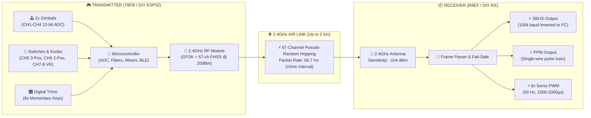
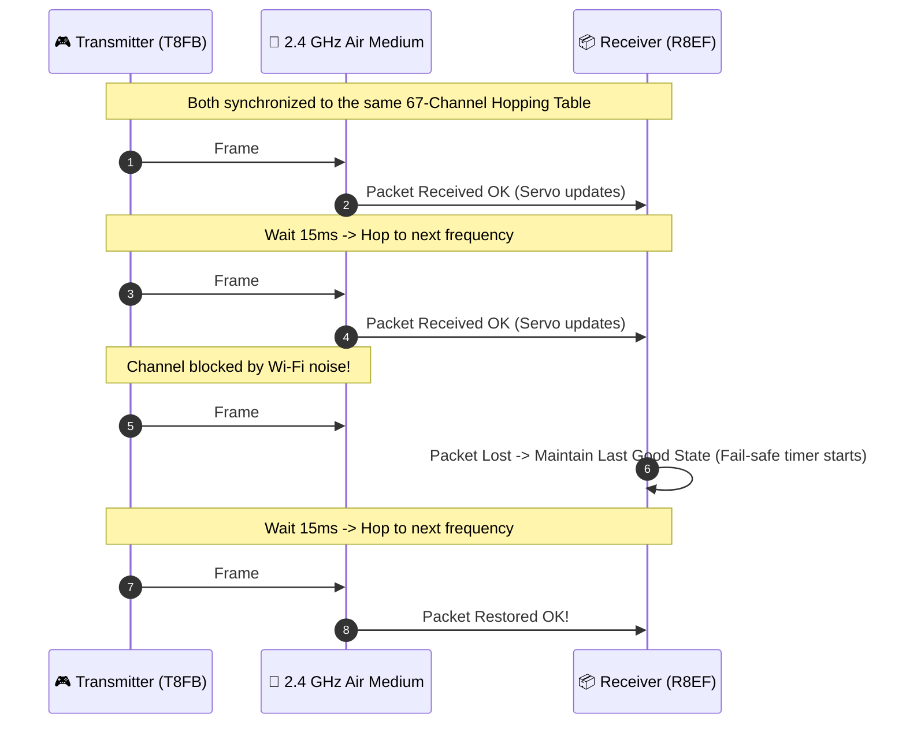
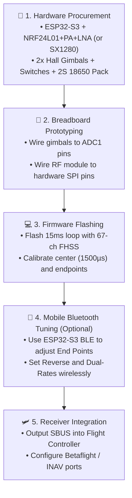

# 🎮 RadioLink T8FB (BT) 8-Channel RC System
### Technical Reference & DIY Maker Blueprint


-red?style=for-the-badge)

-teal?style=for-the-badge)

> [!NOTE]
> **Source Reference:** [RadioLink Official T8FB Specification](https://radiolink.com.cn/t8fb_specification)  
> **Goal:** Complete reverse-engineering breakdown to build a custom, standalone 8-channel 2.4GHz radio transmitter and receiver from scratch.

---

## 📑 Table of Contents

- [⚡ 1. System Architecture at a Glance](#section-1)
- [📊 2. Quick Technical Specifications](#section-2)
  - [📡 Transmitter vs. Receiver Comparison](#section-2-1)
- [🕹️ 3. Physical Layout & Channel Map](#section-3)
  - [📋 Channel Assignments & Signal Ranges](#section-3-1)
- [📶 4. RF Protocol & Frame Timing](#section-4)
  - [⏱️ The 15 ms Frame Timing Loop](#section-4-1)
  - [🔀 FHSS Frequency Hopping Mechanism](#section-4-2)
- [🔌 5. Receiver Signal Protocol Outputs](#section-5)
- [🛠️ 6. DIY Hardware Blueprint: How to Build Your Own](#section-6)
  - [📐 DIY Transmitter Wiring Schematic](#section-6-1)
  - [💻 Core Firmware Logic (ESP32-S3 Arduino C++)](#section-6-2)
- [🎯 7. Step-by-Step DIY Action Plan](#section-7)

---

<a id="section-1"></a>
## ⚡ 1. System Architecture at a Glance



---

<a id="section-2"></a>
## 📊 2. Quick Technical Specifications

<a id="section-2-1"></a>
### 📡 Transmitter vs. Receiver Comparison

| Feature | 🎮 Transmitter (T8FB-BT) | 📦 Receiver (R8EF) | Notes |
| :--- | :---: | :---: | :--- |
| **Channel Count** | **8 Channels** | **8 Channels** | Full simultaneous transmission |
| **Carrier Frequency** | `2400.0 – 2483.5 MHz` | `2400.0 – 2483.5 MHz` | Worldwide license-free 2.4G ISM |
| **Hopping Scheme** | **FHSS (67 Channels)** | **FHSS (Synchronized)** | Pseudo-random hop sequence |
| **Channel Spacing** | `1200 kHz (1.2 MHz)` | `1200 kHz` | Center frequency spacing |
| **Modulation** | **GFSK** | **GFSK** | Low power, high noise immunity |
| **Air Data Rate** | **38 kbps** | **38 kbps** | High sensitivity tuning |
| **TX Power / Sensitivity** | `< 100 mW (+20 dBm)` | **-104 dBm** | Long 2 km line-of-sight budget |
| **Frame Latency** | **15 ms** (~66.7 updates/sec) | **15 ms** | Real-time acrobatic response |
| **Resolution** | **4096 steps** (0.5 µs/step) | **4096 steps** (0.25 µs/step) | 12-bit smooth analog resolution |
| **Operating Voltage** | **4.8 V – 18.0 V DC** | **4.8 V – 10.0 V DC** | TX supports 2S–4S LiPo / 4x AA |
| **Operating Current** | **< 80 mA** | **38 – 45 mA @ 5V** | Extremely battery efficient |
| **Dimensions** | `173 × 102 × 206 mm` | `41.5 × 21.5 × 11.5 mm` | Ultra-compact receiver (7 grams) |
| **Config Interface** | **Bluetooth LE (App) + USB** | Bind Button | No heavy LCD screen needed |

---

<a id="section-3"></a>
## 🕹️ 3. Physical Layout & Channel Map

```
                     ┌────────────────────────────────┐
                     │          ANTENNA (2.4G)        │
                     └───────────────┬────────────────┘
                                     │
                 [SWB]                               [SWA]
             3-POS TOGGLE                        2-POS TOGGLE
           (CH5: Flight Mode)                   (CH6: Arm / Gear)
                   │                                   │
             ┌─────┴─────┐                       ┌─────┴─────┐
             │ [VR1 KNOB]│                       │ [VR2 KNOB]│
             │ CH7: Tilt │                       │ CH8: Aux  │
             └───────────┘                       └───────────┘
               
           ╔═════════════════╗               ╔═════════════════╗
           ║   LEFT GIMBAL   ║               ║  RIGHT GIMBAL   ║
           ║                 ║               ║                 ║
           ║ CH3: Throttle ⬆ ║               ║ CH2: Elevator ⬆ ║
           ║ CH4: Rudder   ⬅ ║               ║ CH1: Aileron  ⬅ ║
           ╚═════════════════╝               ╚═════════════════╝
             [TRIM 3] [TRIM 4]                 [TRIM 2] [TRIM 1]
             
                     ┌────────────────────────────────┐
                     │    POWER SWITCH & STATUS LED   │
                     │    Bluetooth & USB Connectors  │
                     └────────────────────────────────┘
```

<a id="section-3-1"></a>
### 📋 Channel Assignments & Signal Ranges

| CH | Label | Control Device | Movement Axis | Aircraft Role | Signal Output Range |
| :-: | :--- | :--- | :---: | :--- | :---: |
| 🟢 **CH1** | **Aileron** | Right Stick Horizontal | ↔ Left / Right | **Roll Control** | `1000 µs – 2000 µs` (Center: `1500`) |
| 🟢 **CH2** | **Elevator** | Right Stick Vertical | ↕ Up / Down | **Pitch Control** | `1000 µs – 2000 µs` (Center: `1500`) |
| 🟡 **CH3** | **Throttle** | Left Stick Vertical | ↕ Up / Down | **Motor RPM** | `1000 µs – 2000 µs` (Zero: `1000`) |
| 🟢 **CH4** | **Rudder** | Left Stick Horizontal | ↔ Left / Right | **Yaw Control** | `1000 µs – 2000 µs` (Center: `1500`) |
| 🔵 **CH5** | **Aux 1** | 3-Position Switch (SWB) | Pos 1 / 2 / 3 | **Flight Mode** *(Manual/Stab/RTH)* | `1000` / `1500` / `2000 µs` |
| 🟣 **CH6** | **Aux 2** | 2-Position Switch (SWA) | Pos 1 / 2 | **Arm / Disarm / Beeper** | `1000 µs` or `2000 µs` |
| 🟠 **CH7** | **Aux 3** | Rotary Potentiometer (VR1) | 0° – 270° | **Camera Tilt / Flaps** | `1000 µs – 2000 µs` |
| 🟠 **CH8** | **Aux 4** | Rotary Potentiometer (VR2) | 0° – 270° | **Tuning / Pan / Aux** | `1000 µs – 2000 µs` |

> [!TIP]
> **Digital Trims:** 4 independent two-way momentary rocker switches allow step-by-step electronic zero-point calibration without consuming ADC channels.

---

<a id="section-4"></a>
## 📶 4. RF Protocol & Frame Timing

<a id="section-4-1"></a>
### ⏱️ The 15 ms Frame Timing Loop

```
0 ms                       5 ms                      10 ms                      15 ms
│◄───────────────────────────── 15 ms Frame Period ─────────────────────────────►│
├─────────────────────────┬──────────────────────────────────────────────────────┤
│ RF Packet Transmission  │  Transmitter CPU Processing & Sleep (Power Saving)   │
│ (Air Time @ 38 kbps)    │  • Sample 8 ADCs (12-bit)                            │
│ ~5.2 ms Duration        │  • Apply Trims, Dual-Rates & Exponential Curves      │
│ 25 Bytes Packet Data    │  • Calculate CRC16 & Increment Hop Index             │
└─────────────────────────┴──────────────────────────────────────────────────────┘
```

<a id="section-4-2"></a>
### 🔀 FHSS Frequency Hopping Mechanism



---

<a id="section-5"></a>
## 🔌 5. Receiver Signal Protocol Outputs

The R8EF receiver outputs three different signal formats:

```
1. SBUS (Digital Serial Bus):
   [Header 0x0F] [22 Bytes Data (16 Channels x 11 bits)] [Flags] [Footer 0x00]
   ════════════════════════════════════════════════════════════════════════════
   • Inverted UART @ 100,000 Baud (8E2) • Single wire to Flight Controller

2. PPM (Pulse Position Modulation):
   CH1      CH2      CH3      CH4      CH5      CH6      CH7      CH8      SYNC PAUSE
   |--|____|---|____|----|____|--|____|---|____|---|____|----|____|---|____|────────────|
   (Sequential pulses on 1 wire, 22.5ms total frame period)

3. PWM (Parallel Servo Outputs):
   Pin 1 (CH1): ───┐ 1.5ms ┌─────────────────────────── (50 Hz period)
   Pin 2 (CH2): ───┐ 1.5ms ┌───────────────────────────
   Pin 3 (CH3): ───┐ 1.0ms ┌───────────────────────────
   ... Pin 8 (CH8) (8 dedicated standard 3-pin headers: Signal, 5V, GND)
```

---

<a id="section-6"></a>
## 🛠️ 6. DIY Hardware Blueprint: How to Build Your Own

To replicate this radio system using modern DIY hardware, here is the recommended hardware stack:

```
┌────────────────────────────────────────────────────────────────────────┐
│                      DIY Build Bill of Materials                       │
├──────────────────────┬─────────────────────────────┬───────────────────┤
│ Component            │ Recommended Part            │ Why It's Chosen   │
├──────────────────────┼─────────────────────────────┼───────────────────┤
│ 🧠 Master MCU (TX)   │ ESP32-S3 DevKit             │ 240MHz, BLE built-│
│                      │                             │ in for Phone App, │
│                      │                             │ 12b ADC, USB      │
├──────────────────────┼─────────────────────────────┼───────────────────┤
│ 📡 RF Module (Option 1)│ SX1280 2.4GHz Transceiver  │ ExpressLRS-ready, │
│                      │                             │ 10+ km range!     │
├──────────────────────┼─────────────────────────────┼───────────────────┤
│ 📡 RF Module (Option 2)│ NRF24L01+ PA + LNA (2.4GHz)│ Budget-friendly,  │
│                      │                             │ 1.5 km air range  │
├──────────────────────┼─────────────────────────────┼───────────────────┤
│ 🕹️ Gimbals           │ FrSky M9 or Hall Gimbals    │ Contactless Hall, │
│                      │                             │ zero mechanical wear│
├──────────────────────┼─────────────────────────────┼───────────────────┤
│ 🔘 Switches & Pots   │ 1x 3-Pos, 1x 2-Pos, 2x Pots │ Exact T8FB layout │
├──────────────────────┼─────────────────────────────┼───────────────────┤
│ 🔋 Power System      │ 2x 18650 Li-ion + 2S BMS    │ 7.4V, hours of    │
│                      │ + 3.3V/5V Buck Converter    │ continuous runtime│
└──────────────────────┴─────────────────────────────┴───────────────────┘
```

---

<a id="section-6-1"></a>
### 📐 DIY Transmitter Wiring Schematic

```
                          ESP32-S3 Microcontroller
                       ┌────────────────────────────┐
    Right Stick X ─────┤ GPIO 1  (ADC1_CH0 - CH1)   │
    Right Stick Y ─────┤ GPIO 2  (ADC1_CH1 - CH2)   │
    Left Stick Y  ─────┤ GPIO 3  (ADC1_CH2 - CH3)   │
    Left Stick X  ─────┤ GPIO 4  (ADC1_CH3 - CH4)   │
    VR1 Pot (CH7) ─────┤ GPIO 5  (ADC1_CH4)         │
    VR2 Pot (CH8) ─────┤ GPIO 6  (ADC1_CH5)         │
                       │                            │
    SWB (3-pos) P1 ────┤ GPIO 7  (Input Pullup)     │
    SWB (3-pos) P2 ────┤ GPIO 8  (Input Pullup)     │
    SWA (2-pos)    ────┤ GPIO 9  (Input Pullup)     │
                       │                            │
    Trim Rockers   ────┤ GPIO 10 – GPIO 17          │
                       │                            │
    Status Buzzer  ────┤ GPIO 21 (PWM Tone)         │
    WS2812B RGB    ────┤ GPIO 38 (NeoPixel Status)  │
                       │                            │     NRF24L01+ or SX1280
    SPI SCK        ────┤ GPIO 36 ───────────────────┼───> SCK
    SPI MISO       ────┤ GPIO 37 <──────────────────┼──── MISO
    SPI MOSI       ────┤ GPIO 35 ───────────────────┼───> MOSI
    RF CSN         ────┤ GPIO 34 ───────────────────┼───> CSN / NSS
    RF CE          ────┤ GPIO 33 ───────────────────┼───> CE / DIO1
                       │                            │
    Battery Sense  ────┤ GPIO 18 (Voltage Divider)  │<─── Batt (+) [100k/20k]
                       └────────────────────────────┘
```

---

<a id="section-6-2"></a>
### 💻 Core Firmware Logic (ESP32-S3 Arduino C++)

```cpp
#include <SPI.h>
#include <RF24.h> // Or SX1280 driver

// --- Packet Data Structure ---
struct __attribute__((packed)) RC_Packet {
    uint32_t transmitter_id; // Unique pairing ID
    uint16_t ch[8];          // 8 channels (1000 - 2000 µs)
    uint8_t  flags;          // Fail-safe, Bind, Low-battery flags
    uint16_t crc;            // CRC16 verification
};

RC_Packet tx_packet;
RF24 radio(33, 34); // CE, CSN pins

// 67-Channel Frequency Hopping Table (2.4 GHz)
const uint8_t hop_table[67] = {
    4, 12, 20, 28, 36, 44, 52, 60, 68, 76,  2, 10, 18, 26, 34, 42, 50, 58, 66, 74,
    6, 14, 22, 30, 38, 46, 54, 62, 70, 78,  8, 16, 24, 32, 40, 48, 56, 64, 72, 80,
    3, 11, 19, 27, 35, 43, 51, 59, 67, 75,  5, 13, 21, 29, 37, 45, 53, 61, 69, 77,
    7, 15, 23, 31, 39, 47, 55
};
uint8_t hop_index = 0;

void setup() {
    Serial.begin(115200);
    analogReadResolution(12); // 0 - 4095

    radio.begin();
    radio.setPALevel(RF24_PA_MAX);
    radio.setDataRate(RF24_250KBPS); // Or 38kbps on custom transceiver
    radio.openWritingPipe(0xE8E8F0F0E1LL);
    radio.stopListening();
}

void loop() {
    uint32_t t_start = millis();

    // 1. Read Analog Channels (12-bit ADC)
    tx_packet.ch[0] = map(analogRead(1), 0, 4095, 1000, 2000); // CH1: Roll
    tx_packet.ch[1] = map(analogRead(2), 0, 4095, 1000, 2000); // CH2: Pitch
    tx_packet.ch[2] = map(analogRead(3), 0, 4095, 1000, 2000); // CH3: Throttle
    tx_packet.ch[3] = map(analogRead(4), 0, 4095, 1000, 2000); // CH4: Yaw
    tx_packet.ch[6] = map(analogRead(5), 0, 4095, 1000, 2000); // CH7: VR1
    tx_packet.ch[7] = map(analogRead(6), 0, 4095, 1000, 2000); // CH8: VR2

    // 2. Read Switch Channels
    bool p1 = digitalRead(7), p2 = digitalRead(8);
    tx_packet.ch[4] = (!p1 && p2) ? 1000 : (p1 && !p2) ? 2000 : 1500; // CH5 (3-pos)
    tx_packet.ch[5] = digitalRead(9) ? 2000 : 1000;                   // CH6 (2-pos)

    // 3. Set Frequency Channel & Transmit
    radio.setChannel(hop_table[hop_index]);
    radio.write(&tx_packet, sizeof(tx_packet));

    // 4. Advance Hopping Index
    hop_index = (hop_index + 1) % 67;

    // 5. Precise 15 ms Frame Timing Loop (~66.7 Hz)
    while (millis() - t_start < 15) {
        delayMicroseconds(100);
    }
}
```

---

<a id="section-7"></a>
## 🎯 7. Step-by-Step DIY Action Plan



> [!IMPORTANT]
> **Pro Tip for 2026 Builds:** If starting this project today, strongly consider the **SX1280 2.4GHz RF module** running **ExpressLRS (ELRS)** firmware on your ESP32-S3. It delivers **sub-5ms latency**, **10–15 km range**, and has pre-built open-source codebases with full smartphone WebUI configuration.
